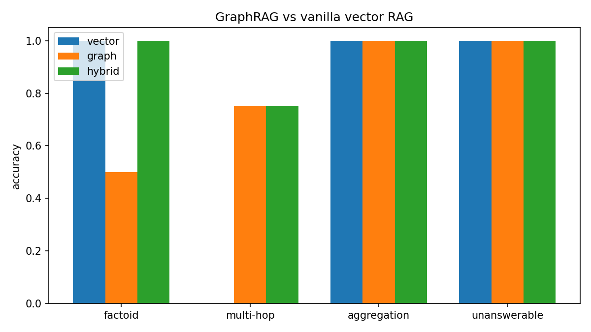

# Intelligent Information Retrieval Using Graph-Based RAG

A small, self-contained demo that compares **vanilla vector RAG** with **GraphRAG** (knowledge-graph retrieval) and a **hybrid** of the two, on questions that need facts from more than one document (multi-hop questions).

Built as a Practice School-I (PS-I) project at J4D Networks Inc. by Kartavya Garhwal, JK Lakshmipat University Jaipur.

## The idea

Vector RAG retrieves text that *looks like* the question. That breaks on multi-hop questions:

> **Who is the CEO of the company that acquired DataFlow Systems?**

One document says *DataFlow Systems was acquired by CloudNine Technologies*. Another says *CloudNine's CEO is Marcus Webb*, and it never mentions DataFlow, so similarity search tends to miss it. GraphRAG stores facts as edges and walks them:

```
DataFlow Systems --acquired_by--> CloudNine Technologies <--ceo_of-- Marcus Webb
```

## How it works

```
documents -> LLM triple extraction -> NetworkX knowledge graph (kg.json)
question  -> seed entities -> 2-hop subgraph -> facts + linked docs -> LLM answer
```

| Strategy | Context given to the LLM |
|---|---|
| `vector` | Top-k document chunk(s) by cosine similarity (default k = 1) |
| `graph` | Facts from the 2-hop neighbourhood of the entities in the question, plus up to 3 linked source documents |
| `hybrid` | Graph facts and documents, plus the single best vector chunk |

All three use the same LLM, the same answer prompt and the same corpus, so any difference comes from retrieval only.

Design choices:

- **NetworkX instead of Neo4j** and **numpy instead of a vector database**: the graph has 22 entities and 24 edges, so a database server adds setup and no benefit.
- **Entity normalization** with an alias dictionary, so "DataFlow" and "DataFlow Systems" become one node.
- **Disk cache** (`llm_cache.json`): every LLM response is stored, so re-runs are instant and free.
- **Default LLM:** GLM-4.7-Flash through Z.ai (free tier). Any OpenAI-compatible endpoint works.

## Quick start

Requires Python 3.9+.

```bash
git clone https://github.com/Kartavya2024/Ps1_Graphrag.git
cd Ps1_Graphrag
pip install openai sentence-transformers networkx numpy pyvis matplotlib
# optional, only to ingest PDF or Word files:
pip install pypdf python-docx
```

Set an API key (from the Z.ai console):

```bash
export ZAI_API_KEY="your-key"      # Windows: set ZAI_API_KEY=your-key
```

`OPENAI_API_KEY` also works; the model then switches to `gpt-4o-mini` automatically.

Run everything (benchmark, chart and graph visualization):

```bash
python graphrag_demo.py
```

The first run downloads the embedding model (about 90 MB) and makes a few dozen LLM calls.

## Commands

| Command | What it does |
|---|---|
| `python graphrag_demo.py` | Full run: benchmark, chart and graph HTML |
| `python graphrag_demo.py ask "question"` | Ask one question and compare vector, graph and hybrid answers |
| `python graphrag_demo.py ingest file.pdf` | Use your own document (.txt, .md, .pdf, .docx); chunks it and rebuilds the graph |
| `python graphrag_demo.py viz --query "..."` | Graph HTML with the traversal path highlighted (red = seeds, orange = traversed) |
| `python graphrag_demo.py eval` | Benchmark only |
| `python graphrag_demo.py build` | Force-rebuild the knowledge graph |
| `python graphrag_demo.py reset` | Go back to the built-in demo corpus |

Try the headline example:

```bash
python graphrag_demo.py ask "Who is the CEO of the company that acquired DataFlow Systems?"
```

## Configuration

Set these as environment variables:

| Variable | Default | Purpose |
|---|---|---|
| `LLM_MODEL` | `glm-4.7-flash` | Model id (try `glm-4.5-flash` if rejected) |
| `LLM_BASE_URL` | `https://api.z.ai/api/paas/v4/` | Endpoint (mainland China: `https://open.bigmodel.cn/api/paas/v4/`) |
| `VECTOR_K` | `1` | Chunks given to the vector baseline; use `3` for real ingested documents |
| `HOPS` | `2` | Graph traversal depth |
| `GRAPH_DOCS` | `3` | Source documents attached to graph facts |
| `MAX_FACTS` | `60` | Cap on graph facts given to the LLM |
| `HF_ENDPOINT` | - | e.g. `https://hf-mirror.com` if Hugging Face is unreachable |

To use your own benchmark, create `questions.json` next to the script:

```json
[
  {"question": "Who founded the company?", "gold": "Jane Smith", "category": "factoid"},
  {"question": "Which university did the founder attend?", "gold": "MIT", "category": "multi-hop"}
]
```

## Results

Benchmark on the built-in corpus (16 fictional documents, 8 questions, GLM-4.7-Flash):

| Category | Questions | Vector | Graph | Hybrid |
|---|---|---|---|---|
| Factoid | 2 | 2 / 2 | 1 / 2 | 2 / 2 |
| Multi-hop | 4 | 0 / 4 | 3 / 4 | 3 / 4 |
| Aggregation | 1 | 1 / 1 | 1 / 1 | 1 / 1 |
| Unanswerable | 1 | 1 / 1 | 1 / 1 | 1 / 1 |
| **Total** | **8** | **4 / 8** | **6 / 8** | **7 / 8** |



Notes on reading these numbers:

- On multi-hop questions, vector RAG answered `Unknown` because the single retrieved chunk lacked the second fact. GraphRAG and hybrid found it through graph traversal.
- Question 5 returned an empty answer for all three methods, and question 2 did for GraphRAG. The script returns an empty string when an LLM call fails five times, so these are most likely API failures (for example free-tier rate limits), not retrieval errors. Failed calls are not cached, so re-running the benchmark retries only those calls.
- The corpus is tiny and each question was run once, so treat this as a demonstration, not a statistical result.

## Repository contents

| File | Description |
|---|---|
| `graphrag_demo.py` | The whole project: extraction, graph, retrieval, evaluation, CLI |
| `kg.json` | Knowledge graph extracted by the LLM |
| `llm_cache.json` | Cached LLM responses |
| `results.json`, `results.csv`, `results.png` | Benchmark answers and chart |
| `knowledge_graph.html` | Interactive graph; open in a browser |

## Limitations

- Extraction quality depends on the LLM; relation direction is not always consistent.
- The alias dictionary for entity normalization is hand-written.
- Fixed hop count; no ranking of edges.
- Community detection and global summaries from the full GraphRAG method are not implemented.
- One LLM call per document is fine for dozens of documents but costly at scale.

## Future work

- Automatic entity resolution instead of a manual alias list.
- Surface API failures instead of returning empty answers.
- Larger benchmark with repeated runs and confidence intervals.
- Sensitivity to `VECTOR_K` and `HOPS`.
- Community summaries for corpus-wide questions.

## References

- Lewis, P. et al. (2020). Retrieval-augmented generation for knowledge-intensive NLP tasks. *NeurIPS 33*.
- Edge, D. et al. (2024). From local to global: A graph RAG approach to query-focused summarization. *arXiv:2404.16130*.
- Reimers, N. and Gurevych, I. (2019). Sentence-BERT. *EMNLP-IJCNLP 2019*.
- Hagberg, A., Schult, D. and Swart, P. (2008). Exploring network structure, dynamics, and function using NetworkX. *SciPy 2008*.
- Yang, Z. et al. (2018). HotpotQA: A dataset for diverse, explainable multi-hop question answering. *EMNLP 2018*.

## Author

Kartavya Garhwal (2024BTech079), B.Tech Computer Science & Engineering, JK Lakshmipat University Jaipur.

External supervisor: Mr. Pankaj Jangid, J4D Networks Inc. Faculty supervisor: Dr. Anamika Satrawala.
